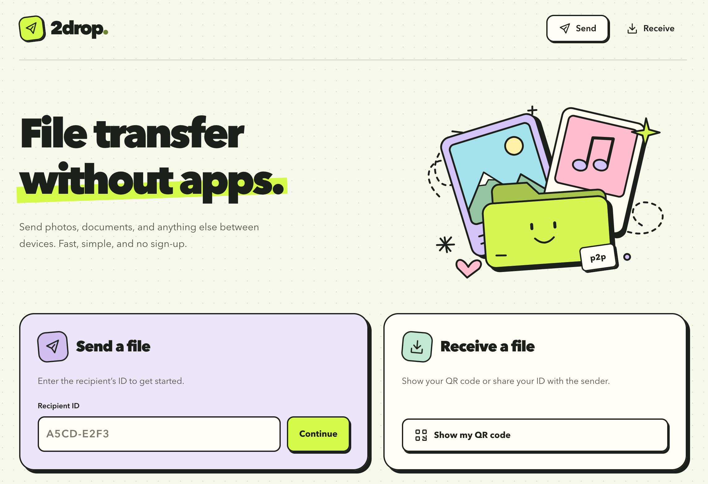

# 2drop

[2drop.app](https://2drop.app) is a lightweight peer-to-peer file transfer tool that runs in your browser. No account or app installation is required.

## Motivation

Sometimes you need to share a sensitive file, such as a password export or a file containing API tokens. Email and cloud storage can leave copies on servers long after the handoff. We built 2drop for those one-off transfers, so you can send files from a phone or computer without uploading them to file storage or installing an app.

## How it works

1. The recipient opens 2drop and shares their receive code or shows their QR code.
2. The sender enters the code or scans the QR code, selects one or more files, and offers the transfer.
3. The recipient reviews the file list and total size, then accepts the transfer. They can download a single file in its original format or download multiple files as one ZIP archive.

Files travel over an encrypted WebRTC connection between the browsers. If a direct connection is unavailable, a relay forwards the encrypted traffic. 2drop does not store the transferred files on its servers.
